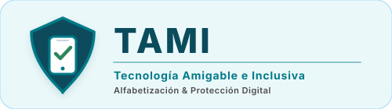

# TAMI - Tecnología Amigable para Mayores e Inclusiva

<p align="center">
  
</p>

Proyecto de la **ET N°20 DE 20 "Carolina Muzilli"** - Polo Educativo de Mataderos.
Curso: 6° 2° - Proyecto Integrador III.

**Misión**: Reducir la brecha digital y mitigar los riesgos de fraude en adultos mayores mediante una plataforma web amigable, inclusiva y accesible.

**Visión**: Un espacio digital donde ninguna persona mayor quede afuera: aprender, protegerse y comunicarse con autonomía.

---

## Qué queremos transmitir

1. **La tecnología es una aliada** — no un motivo de miedo. Sirve para hacer trámites, estar cerca de la familia y aprender todos los días.
2. **Aprender a tu propio ritmo** — letras grandes, botones grandes, pasos cortos y navegación lineal. Sin prisa y sin vergüenza.
3. **Prevenir es mejor que curar** — ante la duda: pará, pensá y consultá. Ese hábito solo evita la mayoría de los fraudes.
4. **Nadie queda afuera** — la inclusión digital es un derecho; si una persona mayor no puede usar la tecnología, el problema está en el diseño.

**Meta medible**: que al menos el **80%** de las personas mayores que prueben TAMI puedan registrarse, navegar y completar una lección sin ayuda de otra persona.

**Impacto buscado**: autonomía y autoestima digital en cada persona mayor → menos angustia y más conversación en las familias → una comunidad con cultura de prevención → un modelo replicable desde una escuela pública para reducir la brecha digital en el mundo.

---

## Lecciones (Campus Educativo)

| # | Módulo | Duración | Nivel | Estado | Qué enseña |
|---|--------|----------|-------|--------|------------|
| 1 | Uso de Smartphones | 30 min | Principiante | Próximamente | Encender el celular, llamadas y mensajes, fotos, WiFi, bloqueo de pantalla, permisos de apps |
| 2 | Redes e Internet | 40 min | Principiante | Próximamente | Buscar información verdadera, reconocer sitios seguros, correo, privacidad en redes, publicidad y datos |
| 3 | Trámites en Línea | 45 min | Intermedio | Próximamente | Cuenta gov / clave fiscal, constancias, pagos en línea y verificación del sitio oficial |
| 4 | Fraudes Digitales (Phishing) | 35 min | Principiante | **Disponible** | Qué es el phishing, cómo reconocer mensajes falsos, qué hacer, ejemplos reales y examen final |
| 5 | Comunicación Digital | 25 min | Principiante | Próximamente | WhatsApp y videollamadas con la familia, grupos, cadenas y suplantación de contactos |

El Módulo 4 es una lección de **5 pasos** con navegación lineal y consejos en cada paso, y se cierra con un examen rápido de 3 preguntas.

---

## Equipo (Scrum) y Responsabilidades

| Integrante             | Rol de Scrum               | Responsabilidades específicas                                          |
|------------------------|----------------------------|-------------------------------------------------------------------------|
| Nahuel Luciano Ancelmo | Product Owner (PO)         | Definir la visión del producto, priorizar el backlog y validar el PMV.  |
| Rachael Choque         | Scrum Master (SM)          | Facilitar las ceremonias, eliminar impedimentos y cuidar el proceso.    |
| Ezequiel Charca        | Equipo de Desarrollo (Dev) | Diseñar y construir la interfaz, la lógica y la capa de persistencia.   |

---

## Tecnología y Arquitectura

- **Frontend**: HTML5, CSS3 y JavaScript nativo (sin framework).
- **Backend**: Node.js + Express + PostgreSQL (**Supabase**).
- **Arquitectura**: Cliente-Servidor en 3 capas (Presentación, Lógica y Datos).
- **Seguridad**: contraseñas con hashing irreversible **bcrypt** y consultas SQL parametrizadas.
- **Persistencia**: Supabase/PostgreSQL (principal) y LocalStorage (caché/fallback sin conexión).
- **Accesibilidad**: WCAG 2.1 AA, ARIA roles, skip link, breadcrumbs, contraste alto, botones mínimos 52px.
- **Design System**: "Protección Proactiva" (paleta 60-30-10: `#EBF8FA` / `#0A4B5C` / `#007A87`).

---

## PMV V1.0 - Funcionalidades Implementadas

### 1. Pantalla de Inicio (Presentación del proyecto)
- Logo institucional (`img/logo.svg`) y favicon (`img/icono.svg`) implementados en toda la interfaz (header, hero y footer).
- Contenido detallado en tarjetas: **qué queremos transmitir** (4 pilares), el problema que resuelve, las **5 lecciones** explicadas, el recorrido de aprendizaje y el **impacto** buscado.
- CTA al inicio y al final de la página: "Crear mi cuenta" y "Ya tengo cuenta, ingresar".
- Diseño legible: medida de texto de ~70 caracteres, sin desbordes horizontales y tarjetas con bordes y sombras institucionales.

### 2. Pantalla de Registro y Login
- Formulario con campos: Nombre, Correo Electrónico, Contraseña.
- Validación de nombre no vacío, formato de email válido y contraseña mínima de 6 caracteres.
- Hashing de contraseña con **bcrypt** (costo 12) en el servidor, con consultas SQL parametrizadas.
- Persistencia en Supabase/PostgreSQL (principal) y LocalStorage (fallback offline).

### 3. Test de Nivelación Obligatorio
- 3 preguntas sencillas con botones gigantes de opción múltiple.
- Evalúa nivel digital inicial del usuario ("Principiante" o "Protegido").
- Resultados guardados en Supabase/PostgreSQL y LocalStorage.

### 4. Dashboard Principal (Entorno Seguro)
- Saludo personalizado: "¡Hola, [Nombre]! Estás en un entorno totalmente seguro 🔒".
- 3 accesos masivos tipo tarjeta: Campus Educativo, Escudo de Seguridad, Mi Progreso.
- **Breadcrumbs** (migas de pan) en cada pantalla: los niveles previos son clicables y el actual es texto plano.

### 5. Campus Educativo (Módulo de Fraude Digital)
- 5 módulos teóricos: Smartphones, Redes, Trámites, Fraudes, Comunicación.
- Solo el Módulo 4 (Fraudes Digitales/Phishing) está activo en esta versión.
- Lección interactiva paso a paso con navegación lineal (5 pasos).

### 6. Escudo de Seguridad (Centro de Alertas)
- 6 alertas de seguridad en tiempo real con explicaciones y consejos.
- Cada alerta incluye: título, descripción, severidad y "Qué hacer".
- Datos cargados desde la API (con fallback offline).

### 7. Sistema de Evaluación y Progreso
- Examen rápido post-lección (3 preguntas sobre phishing).
- Gráficos de barras CSS que comparan nivel inicial vs. examen.
- Progreso guardado en Supabase/PostgreSQL y mostrado en "Mi Progreso".

---

## Mapa del Repositorio

```text
Grupo-TAMI/
├── README.md               Documentación principal del proyecto
├── .gitignore              Excluye node_modules/ y server/.env
├── code/                   Capa de Presentación y Lógica (frontend)
│   ├── index.html          Estructura accesible con 10 pantallas SPA + breadcrumbs
│   ├── styles.css          Design System "Protección Proactiva"
│   ├── main.js             Lógica + conexión API + fallback LocalStorage
│   └── README.md
├── img/                    Marca oficial del sitio
│   ├── logo.svg            Logo institucional (encabezado de la pantalla Inicio)
│   └── icono.svg           Icono/escudo (favicon, header y footer)
├── server/                 Backend Node.js + Express + PostgreSQL (Supabase)
│   ├── index.js            Servidor y rutas API
│   ├── db.js               Conexión a Supabase (pg Pool + SSL)
│   ├── schema.sql          Esquema de 7 tablas + datos iniciales
│   ├── scripts/
│   │   └── migrate.js      npm run db:migrate → aplica schema.sql en Supabase
│   ├── routes/
│   │   ├── usuarios.js     Registro/login con bcrypt + progreso
│   │   ├── cursos.js       Listado de módulos/curso
│   │   ├── alertas.js      Alertas de fraude
│   │   └── progreso.js     Test, exámenes y progreso de módulos
│   ├── .env                Credenciales de Supabase (ignorado por git)
│   ├── .env.example        Variables de entorno de ejemplo
│   └── README.md
├── resources/              Activos multimedia
│   ├── img/                Imágenes (optimizadas)
│   ├── icons/              Iconografía SVG de trazo grueso
│   ├── fonts/              Tipografías locales legibles
│   ├── branding-guide.md   Paleta cromática proactiva
│   └── README.md
├── actividades hechas/      Registro de las actividades del Proyecto Integrador
│   ├── mapa-de-navegacion.md
│   ├── auditoria-usabilidad-ux.md
│   └── cronograma-ejecucion-rapida.md
└── docs/                   Documentación obligatoria (ET N°20)
    ├── project-charter.md        Project Charter
    ├── plan-de-proyecto.md       Plan de Proyecto
    ├── cronograma-gantt.md       Diagrama de Gantt + plan de 10 días
    ├── backlog-sprints.md        Backlog y Sprint 1 (autenticación)
    ├── design-system.md          Design System
    ├── convenciones-desarrollo.md  Convenciones ISO/IEC 25010
    ├── arquitectura-informacion.md Árbol de navegación y breadcrumbs
    ├── auditoria-usabilidad.md   Auditoría UX (6 dimensiones + QA)
    ├── plan-ejecucion-10-dias.md Cronograma rápido día a día
    └── README.md
```

---

## Marca y Recursos Gráficos

| Recurso | Archivo | Dónde se usa |
|---------|---------|--------------|
| Logo institucional | `img/logo.svg` | Pantalla de Inicio (encabezado del hero) |
| Icono / escudo | `img/icono.svg` | Favicon de la pestaña, header y footer |

- Ambos son **SVG vectoriales** (escalables y de peso mínimo) con la paleta "Protección Proactiva".
- Normas de uso, contraste y tipografía en la [Guía de marca](resources/branding-guide.md) y [resources/README.md](resources/README.md).
- Los textos decorativos llevan `alt=""` + `aria-hidden`; el logo informativo tiene `alt` descriptivo.

---

## Base de Datos (Supabase)

La base de datos corre en **[Supabase](https://supabase.com)** (PostgreSQL
gestionado en la nube, pooler de Supabase con SSL). Las credenciales viven en
`server/.env`, que **no se sube al repositorio**.

### Tablas

| Tabla | Descripción |
|-------|-------------|
| `usuarios` | Usuarios registrados con nombre, email, password_hash (bcrypt) y nivel_digital |
| `cursos` | 5 módulos del Campus Educativo |
| `alertas_fraude` | 6 alertas con título, descripción, que_hacer, severidad e icono |
| `inscripciones` | Relación many-to-many usuario-curso |
| `test_nivelacion` | Resultados del test inicial (respuestas JSONB, nivel, puntaje) |
| `examenes` | Resultados del examen post-lección |
| `progreso_modulos` | Avance paso a paso en cada módulo |

### API REST - Endpoints

| Método | Ruta | Descripción |
|--------|------|-------------|
| GET | `/` | Estado de la API |
| GET | `/api/usuarios` | Listar todos los usuarios |
| GET | `/api/usuarios/:id` | Obtener un usuario por ID |
| POST | `/api/usuarios/registrar` | Registrar nuevo usuario (nombre, email, password) |
| POST | `/api/usuarios/login` | Iniciar sesión (email, password) |
| GET | `/api/usuarios/:id/progreso` | Obtener progreso completo de un usuario |
| GET | `/api/cursos` | Listar cursos activos |
| GET | `/api/cursos/:id` | Obtener un curso |
| GET | `/api/alertas` | Listar alertas de fraude |
| POST | `/api/progreso/test` | Guardar resultado de test de nivelación |
| POST | `/api/progreso/examen` | Guardar resultado de examen post-lección |
| POST | `/api/progreso/modulo` | Guardar/actualizar progreso en un módulo |
| GET | `/api/progreso/:usuarioId` | Obtener progreso de un usuario |

---

## Puesta en Marcha

### Requisitos Previos
- [Node.js](https://nodejs.org) (v16 o superior)
- Una instancia de **Supabase** (ya configurada en `server/.env`)

### 1. Clonar el repositorio

```bash
git clone https://github.com/charcaezequiel/Grupo-TAMI.git
cd Grupo-TAMI
```

### 2. Configurar la base de datos

Las credenciales de Supabase están en `server/.env`:

```env
DB_HOST=aws-0-us-east-1.pooler.supabase.com
DB_PORT=5432
DB_USER=postgres.wpsgmnmrvmhywnxrytyt
DB_PASSWORD=<password de Supabase>
DB_NAME=postgres
DB_SSL=true
PORT=3000
```

Verificar la conexión y crear las tablas (idempotente):

```bash
cd server
npm run db:check     # prueba la conexión con Supabase
npm run db:migrate   # crea las tablas y carga los datos iniciales
```

### 3. Instalar dependencias y arrancar

```bash
cd server
npm install
npm start
# o para desarrollo con auto-reload:
npm run dev
```

El servidor queda disponible en `http://localhost:3000` y al arrancar imprime
`[DB] Conectado a Supabase → ...` si la conexión fue exitosa.

### Scripts disponibles (`server/`)

| Comando | Qué hace |
|---------|----------|
| `npm start` | Levanta la API en `http://localhost:3000` |
| `npm run dev` | Lo mismo, con auto-reload al guardar archivos |
| `npm run db:check` | Verifica la conexión con Supabase |
| `npm run db:migrate` | Crea las tablas y carga los datos iniciales (idempotente) |

### 4. Abrir el frontend

Abrí `code/index.html` directamente en tu navegador (doble clic o arrastrá el archivo).

> **Nota**: El frontend intenta conectarse a la API en `http://localhost:3000`. Si el servidor no está disponible, funciona automáticamente con LocalStorage como caché offline.

---

## Diseño de Software (ISO/IEC 25010)

- **Alta Cohesión y Bajo Acoplamiento**: Funciones modulares con responsabilidad única, comunicación vía eventos y llamadas directas.
- **Reusabilidad**: Funciones de validación, renderizado y guardado reutilizables en todas las pantallas.
- **Nomenclatura Estricta**: camelCase para variables (sustantivos), infinitivo para funciones (verbos), booleanos como preguntas.
- **Comentarios Profesionales**: Solo explican el "porqué" de decisiones complejas.
- **Mantenibilidad**: Convenciones documentadas en `docs/convenciones-desarrollo.md`.
- **Accesibilidad**: ARIA labels, roles, aria-live, skip link, breadcrumbs, contraste WCAG AA, target size 52px+.

## Justificación: Relación Teoría-Práctica

- **Scrum**: Roles (PO, SM, Dev) organizan la colaboración y el avance por sprints documentado en `docs/backlog-sprints.md`.
- **DCU (Diseño Centrado en el Usuario)**: Paleta proactiva, iconos de trazo grueso, fuentes de alta legibilidad y botones masivos para adultos mayores.
- **Arquitectura de Información**: Navegación de 3 niveles con breadcrumbs definida en `docs/arquitectura-informacion.md`.
- **Calidad (ISO/IEC 25010)**: Métricas, auditoría UX y matriz de hallazgos en `docs/auditoria-usabilidad.md`.
- **PMV (Producto Mínimo Viable)**: Sistema funcional completo con backend, frontend, base de datos y persistencia offline.

---

## Enlaces

- [Documentación técnica](docs/README.md)
- [Guía de marca](resources/branding-guide.md)
- [Recursos gráficos (logo e iconos)](resources/README.md)
- [Backend - API REST](server/README.md)
- [Frontend - Interfaz](code/README.md)
- [Esquema de la base de datos](server/schema.sql)

---

## Licencia

Proyecto educativo - ET N°20 "Carolina Muzilli" (2026).
